# OpenGameArt: 2D art

**119 assets from [OpenGameArt](https://opengameart.org), dedicated to the public domain under [CC0](https://creativecommons.org/publicdomain/zero/1.0/).** Use them in any game, free or paid, and change them however you like; no credit is needed.

2D art from OpenGameArt entries licensed CC0 (some also offer other licences; CC0 is the one that applies here). 827.4 MB in all.

This is a copy kept by [zuujis-cc0](https://github.com/zuujis-cc0) so game makers can take single files from GitHub. It is not made by or affiliated with OpenGameArt: the originals, often in more formats and higher resolutions, are on [opengameart.org](https://opengameart.org). If they help you, consider [supporting OpenGameArt](https://opengameart.org/content/faq).

Every file is listed in [MANIFEST.tsv](MANIFEST.tsv) with its size and SHA-256. More free assets: [the Zuujis collection](https://github.com/zuujis-cc0/free-game-assets#readme).

| | | | |
| :-: | :-: | :-: | :-: |
| <a href="n64-medallions">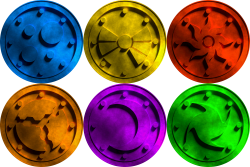</a> <b><a href="n64-medallions">N64 Medallions</a></b> by n64guy · <a href="https://opengameart.org/content/n64-medallions">source</a> | <a href="nature-props-aquatic-underwater">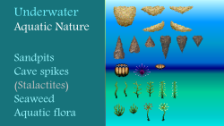</a> <b><a href="nature-props-aquatic-underwater">Nature Props Aquatic Underwater</a></b> by Reactorcore · <a href="https://opengameart.org/content/nature-props-aquatic-underwater">source</a> | <a href="nature-props-surface-forest">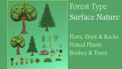</a> <b><a href="nature-props-surface-forest">Nature Props Surface Forest</a></b> by Reactorcore · <a href="https://opengameart.org/content/nature-props-surface-forest">source</a> | <a href="nekomimi-girl-portrait">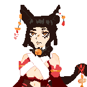</a> <b><a href="nekomimi-girl-portrait">Nekomimi girl portrait</a></b> by Cawfeecrow · <a href="https://opengameart.org/content/nekomimi-girl-portrait">source</a> |
| <a href="neon-ui">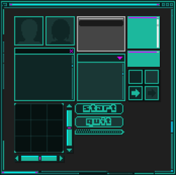</a> <b><a href="neon-ui">Neon UI</a></b> by knekko · <a href="https://opengameart.org/content/neon-ui">source</a> |  <b><a href="new-cursor-ghost-hand">New cursor: Ghost Hand</a></b> by Tisroc · <a href="https://opengameart.org/content/new-cursor-ghost-hand">source</a> | <a href="ninja-and-more">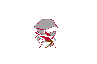</a> <b><a href="ninja-and-more">Ninja and more</a></b> by Guy G. Gamerson · <a href="https://opengameart.org/content/ninja-and-more">source</a> | <a href="ninja-character-0">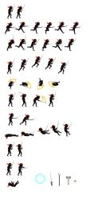</a> <b><a href="ninja-character-0">Ninja Character</a></b> by veeru5656 · <a href="https://opengameart.org/content/ninja-character-0">source</a> |
| <a href="not-seamless-poorly-made-laser-tile-thing">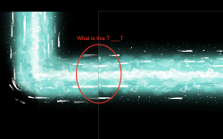</a> <b><a href="not-seamless-poorly-made-laser-tile-thing">(Not seamless :/ ) Poorly-made laser tile thing</a></b> by aspiringcodemonkey · <a href="https://opengameart.org/content/not-seamless-poorly-made-laser-tile-thing">source</a> | <a href="npc-static-shopkeepers">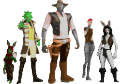</a> <b><a href="npc-static-shopkeepers">NPC static shopkeepers</a></b> by Puffolotti · <a href="https://opengameart.org/content/npc-static-shopkeepers">source</a> | <a href="ocean-background-0">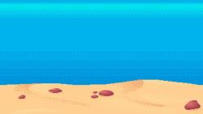</a> <b><a href="ocean-background-0">Ocean background</a></b> by WizardEel · <a href="https://opengameart.org/content/ocean-background-0">source</a> | <a href="oga-sara-16x16-1bit-color">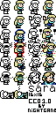</a> <b><a href="oga-sara-16x16-1bit-color">OGA Sara 16x16 (1bit & Color)</a></b> by nightgane · <a href="https://opengameart.org/content/oga-sara-16x16-1bit-color">source</a> |
| <a href="old-school-fps-wall-textures">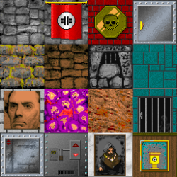</a> <b><a href="old-school-fps-wall-textures">Old school fps wall textures</a></b> by knekko · <a href="https://opengameart.org/content/old-school-fps-wall-textures">source</a> | <a href="oldschool-fps-decoration-sprites">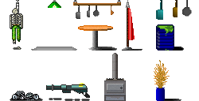</a> <b><a href="oldschool-fps-decoration-sprites">Oldschool FPS decoration sprites</a></b> by knekko · <a href="https://opengameart.org/content/oldschool-fps-decoration-sprites">source</a> | <a href="orbital-satellite-ion-cannon">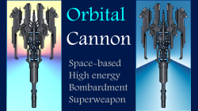</a> <b><a href="orbital-satellite-ion-cannon">Orbital Satellite Ion Cannon</a></b> by Reactorcore · <a href="https://opengameart.org/content/orbital-satellite-ion-cannon">source</a> | <a href="overworld-grass-extention">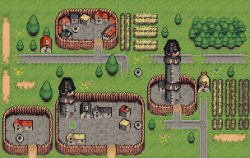</a> <b><a href="overworld-grass-extention">Overworld Grass Extention</a></b> by knekko · <a href="https://opengameart.org/content/overworld-grass-extention">source</a> |
| <a href="overworld-monastery">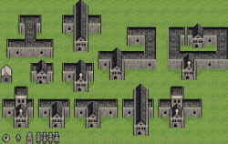</a> <b><a href="overworld-monastery">Overworld - Monastery</a></b> by knekko · <a href="https://opengameart.org/content/overworld-monastery">source</a> | <a href="pastel-caves">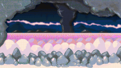</a> <b><a href="pastel-caves">Pastel Caves</a></b> by Spring Spring · <a href="https://opengameart.org/content/pastel-caves">source</a> | <a href="pc-style-playing-cards">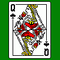</a> <b><a href="pc-style-playing-cards">PC-style playing cards</a></b> by devurandom · <a href="https://opengameart.org/content/pc-style-playing-cards">source</a> | <a href="pebonius-edited-faces">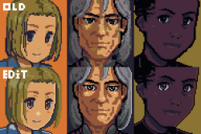</a> <b><a href="pebonius-edited-faces">Pebonius - Edited Faces</a></b> by Pixel Archer · <a href="https://opengameart.org/content/pebonius-edited-faces">source</a> |
| <a href="pencil-and-eraser">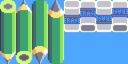</a> <b><a href="pencil-and-eraser">Pencil and Eraser</a></b> by Pixel Archer · <a href="https://opengameart.org/content/pencil-and-eraser">source</a> | <a href="piano-key-illustrations-88-to-25-key">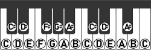</a> <b><a href="piano-key-illustrations-88-to-25-key">Piano Key Illustrations- 88 to 25 key</a></b> by CodyS · <a href="https://opengameart.org/content/piano-key-illustrations-88-to-25-key">source</a> | <a href="pico-run">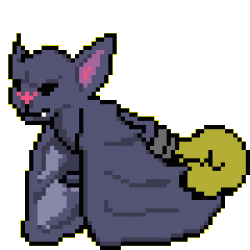</a> <b><a href="pico-run">PICO RUN</a></b> by PegasuTV · <a href="https://opengameart.org/content/pico-run">source</a> | <a href="pillar-obstacle">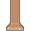</a> <b><a href="pillar-obstacle">Pillar Obstacle</a></b> by draganasgamesart · <a href="https://opengameart.org/content/pillar-obstacle">source</a> |
| <a href="pixel-art-characters-25x">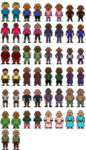</a> <b><a href="pixel-art-characters-25x">Pixel Art Characters (25x)</a></b> by Lyricsz · <a href="https://opengameart.org/content/pixel-art-characters-25x">source</a> |  <b><a href="pixel-art-firey-crimson-moon">Pixel art firey crimson moon</a></b> by realassets_. · <a href="https://opengameart.org/content/pixel-art-firey-crimson-moon">source</a> | <a href="pixel-art-icons">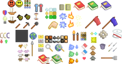</a> <b><a href="pixel-art-icons">Pixel art icons</a></b> by ChikenwingJJA · <a href="https://opengameart.org/content/pixel-art-icons">source</a> |  <b><a href="pixel-art-isometric-tank">Pixel art, isometric tank</a></b> by Soliforx · <a href="https://opengameart.org/content/pixel-art-isometric-tank">source</a> |
| <a href="pixel-art-isometric-terrain-tiles">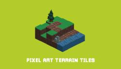</a> <b><a href="pixel-art-isometric-terrain-tiles">Pixel Art Isometric Terrain Tiles</a></b> by acasas · <a href="https://opengameart.org/content/pixel-art-isometric-terrain-tiles">source</a> | <a href="pixel-art-top-down-dungeon-tileset-and-rpg-character-with-animations">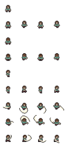</a> <b><a href="pixel-art-top-down-dungeon-tileset-and-rpg-character-with-animations">Pixel art top down dungeon tileset and rpg character with animations</a></b> by profpatonildo · <a href="https://opengameart.org/content/pixel-art-top-down-dungeon-tileset-and-rpg-character-with-animations">source</a> | <a href="pixel-city-background">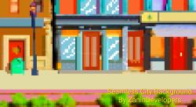</a> <b><a href="pixel-city-background">Pixel City Background</a></b> by ZaninDevelopers · <a href="https://opengameart.org/content/pixel-city-background">source</a> |  <b><a href="pixel-coin-heads-tails">Pixel Coin (Heads & Tails)</a></b> by BlueburryKay · <a href="https://opengameart.org/content/pixel-coin-heads-tails">source</a> |
| <a href="pixel-crosshairs"></a> <b><a href="pixel-crosshairs">Pixel Crosshairs</a></b> by Donitz · <a href="https://opengameart.org/content/pixel-crosshairs">source</a> |  <b><a href="pixel-keys">Pixel Keys</a></b> by iyol · <a href="https://opengameart.org/content/pixel-keys">source</a> | <a href="pixel-platformer-extension-%E2%80%93-edited-asset-pack">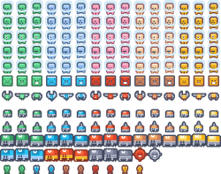</a> <b><a href="pixel-platformer-extension-%E2%80%93-edited-asset-pack">Pixel Platformer Extension – Edited Asset Pack</a></b> by Arce_NK · <a href="https://opengameart.org/content/pixel-platformer-extension-%E2%80%93-edited-asset-pack">source</a> | <a href="pixel-tile-set">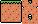</a> <b><a href="pixel-tile-set">Pixel Tile Set</a></b> by Ledebi · <a href="https://opengameart.org/content/pixel-tile-set">source</a> |
| <a href="pixel-vehicle-pack-0">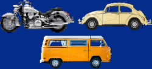</a> <b><a href="pixel-vehicle-pack-0">Pixel Vehicle Pack</a></b> by ZaninDevelopers · <a href="https://opengameart.org/content/pixel-vehicle-pack-0">source</a> | <a href="pixel-wizard-girl">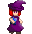</a> <b><a href="pixel-wizard-girl">Pixel wizard girl</a></b> by mailbun · <a href="https://opengameart.org/content/pixel-wizard-girl">source</a> |  <b><a href="pixelated-button-for-2d-platformer">Pixelated Button (for 2D Platformer)</a></b> by c0ffeenn_ · <a href="https://opengameart.org/content/pixelated-button-for-2d-platformer">source</a> | <a href="pixelated-malformed-zombie-0">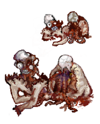</a> <b><a href="pixelated-malformed-zombie-0">Pixelated Malformed Zombie</a></b> by arzaaa · <a href="https://opengameart.org/content/pixelated-malformed-zombie-0">source</a> |
| <a href="planet-surface-skyboxes">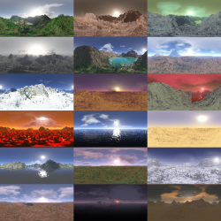</a> <b><a href="planet-surface-skyboxes">Planet Surface Skyboxes</a></b> by Screaming Brain Studios · <a href="https://opengameart.org/content/planet-surface-skyboxes">source</a> | <a href="plant-and-mushroom-enemies-in-aseprite">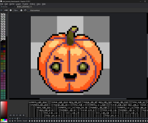</a> <b><a href="plant-and-mushroom-enemies-in-aseprite">Plant and Mushroom Enemies in Aseprite</a></b> by hatmix · <a href="https://opengameart.org/content/plant-and-mushroom-enemies-in-aseprite">source</a> | <a href="plasma-electric-effect-animations">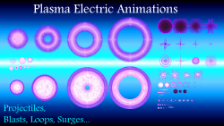</a> <b><a href="plasma-electric-effect-animations">Plasma Electric Effect Animations</a></b> by Reactorcore · <a href="https://opengameart.org/content/plasma-electric-effect-animations">source</a> | <a href="platformer-tileset-5">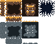</a> <b><a href="platformer-tileset-5">Platformer Tileset</a></b> by VluDs · <a href="https://opengameart.org/content/platformer-tileset-5">source</a> |
| <a href="platforming-tiles-and-an-animated-flame">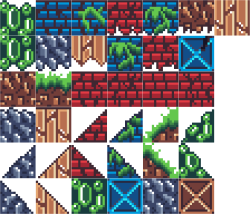</a> <b><a href="platforming-tiles-and-an-animated-flame">Platforming Tiles and an animated Flame</a></b> by Pro Sensory · <a href="https://opengameart.org/content/platforming-tiles-and-an-animated-flame">source</a> | <a href="playing-cards-back-vector-svg">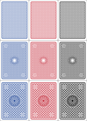</a> <b><a href="playing-cards-back-vector-svg">Playing cards back vector svg</a></b> by BdRGames · <a href="https://opengameart.org/content/playing-cards-back-vector-svg">source</a> | <a href="pong-pixel-art">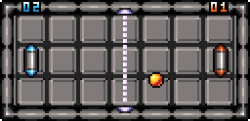</a> <b><a href="pong-pixel-art">Pong Pixel Art</a></b> by ElectDraw · <a href="https://opengameart.org/content/pong-pixel-art">source</a> | <a href="post-apocalyptic-set-pixel-art">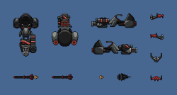</a> <b><a href="post-apocalyptic-set-pixel-art">Post-Apocalyptic Set (Pixel Art)</a></b> by DreyArts · <a href="https://opengameart.org/content/post-apocalyptic-set-pixel-art">source</a> |
|  <b><a href="potion-16x-red-and-blue">Potion 16x (Red and Blue)</a></b> by MatiasVME · <a href="https://opengameart.org/content/potion-16x-red-and-blue">source</a> | <a href="potion-icons-1">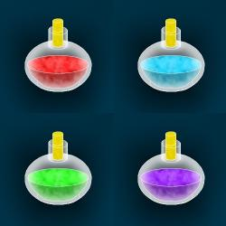</a> <b><a href="potion-icons-1">Potion Icons</a></b> by Oyasumi · <a href="https://opengameart.org/content/potion-icons-1">source</a> | <a href="potions-pack">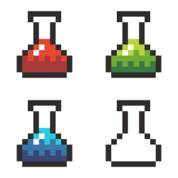</a> <b><a href="potions-pack">Potions Pack</a></b> by FunnyDude · <a href="https://opengameart.org/content/potions-pack">source</a> | <a href="prehistoric-bird">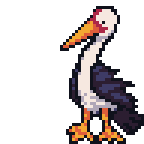</a> <b><a href="prehistoric-bird">Prehistoric Bird</a></b> by ARoachIFoundOnMyPillow · <a href="https://opengameart.org/content/prehistoric-bird">source</a> |
| <a href="psrc-human-mk2-and-ultimate-devkit">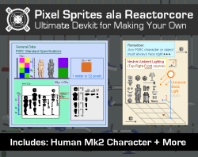</a> <b><a href="psrc-human-mk2-and-ultimate-devkit">PSRC Human Mk2 and Ultimate Devkit</a></b> by Reactorcore · <a href="https://opengameart.org/content/psrc-human-mk2-and-ultimate-devkit">source</a> |  <b><a href="pumping-heart-0">Pumping Heart</a></b> by Lyricsz · <a href="https://opengameart.org/content/pumping-heart-0">source</a> |  <b><a href="pumpkin-man">Pumpkin man</a></b> by Mirax2 · <a href="https://opengameart.org/content/pumpkin-man">source</a> | <a href="purple-ghost-bunny-sprite">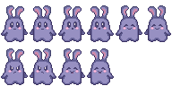</a> <b><a href="purple-ghost-bunny-sprite">Purple Ghost Bunny Sprite</a></b> by cwendeku · <a href="https://opengameart.org/content/purple-ghost-bunny-sprite">source</a> |
| <a href="purple-puma-pixel-art-spritesheet">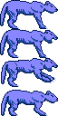</a> <b><a href="purple-puma-pixel-art-spritesheet">Purple Puma pixel art spritesheet</a></b> by nightgane · <a href="https://opengameart.org/content/purple-puma-pixel-art-spritesheet">source</a> | <a href="purple-water">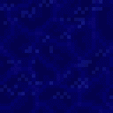</a> <b><a href="purple-water">Purple Water</a></b> by elfy_boo · <a href="https://opengameart.org/content/purple-water">source</a> |  <b><a href="pyro-sprite-sheet">Pyro Sprite Sheet</a></b> by Bing Soy · <a href="https://opengameart.org/content/pyro-sprite-sheet">source</a> | <a href="quake-i-palette-and-colormaps">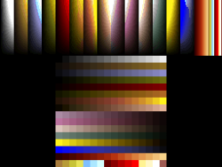</a> <b><a href="quake-i-palette-and-colormaps">Quake I Palette and Colormaps</a></b> by Croomfolk · <a href="https://opengameart.org/content/quake-i-palette-and-colormaps">source</a> |
|  <b><a href="rabbit-head-sprite-sheet">Rabbit Head Sprite Sheet</a></b> by Technopeasant · <a href="https://opengameart.org/content/rabbit-head-sprite-sheet">source</a> |  <b><a href="race-tracks-0">race tracks</a></b> by julijj · <a href="https://opengameart.org/content/race-tracks-0">source</a> |  <b><a href="radar">Radar</a></b> by Tsorthan Grove · <a href="https://opengameart.org/content/radar">source</a> |  <b><a href="realistic-spinning-ring-spritesheets">Realistic spinning ring spritesheets</a></b> by KillGorack · <a href="https://opengameart.org/content/realistic-spinning-ring-spritesheets">source</a> |
|  <b><a href="red-spikes">Red Spikes</a></b> by MrOnion · <a href="https://opengameart.org/content/red-spikes">source</a> |  <b><a href="resource-bubbles">Resource bubbles</a></b> by KillGorack · <a href="https://opengameart.org/content/resource-bubbles">source</a> |  <b><a href="riot-shields-and-ballistic-shields">Riot shields and ballistic shields</a></b> by knekko · <a href="https://opengameart.org/content/riot-shields-and-ballistic-shields">source</a> |  <b><a href="rocket-thruster-effect-animations">Rocket Thruster Effect Animations</a></b> by Reactorcore · <a href="https://opengameart.org/content/rocket-thruster-effect-animations">source</a> |
|  <b><a href="roguelike-16-color-icons">Roguelike 16 color icons</a></b> by nublet · <a href="https://opengameart.org/content/roguelike-16-color-icons">source</a> |  <b><a href="rotating-floppy">Rotating floppy</a></b> by Liot · <a href="https://opengameart.org/content/rotating-floppy">source</a> |  <b><a href="rotating-jewels">Rotating Jewels</a></b> by KillGorack · <a href="https://opengameart.org/content/rotating-jewels">source</a> |  <b><a href="rough-industrial-combat-props">Rough Industrial Combat Props</a></b> by Reactorcore · <a href="https://opengameart.org/content/rough-industrial-combat-props">source</a> |
|  <b><a href="rpg-character-knight">RPG Character (Knight)</a></b> by 3DPyramid · <a href="https://opengameart.org/content/rpg-character-knight">source</a> |  <b><a href="rpg-cursor">rpg cursor</a></b> by ljk9000 · <a href="https://opengameart.org/content/rpg-cursor">source</a> |  <b><a href="rpg-fantasy-icons-portraits-monsters-heroes-vampires">RPG Fantasy icons portraits - monsters, heroes, vampires</a></b> by Pan długa ryba · <a href="https://opengameart.org/content/rpg-fantasy-icons-portraits-monsters-heroes-vampires">source</a> |  <b><a href="rpg-house-low-res-remix">RPG house low-res remix</a></b> by knekko · <a href="https://opengameart.org/content/rpg-house-low-res-remix">source</a> |
|  <b><a href="runy-tilemap">Runy tilemap</a></b> by BunnyX · <a href="https://opengameart.org/content/runy-tilemap">source</a> |  <b><a href="santa-claus-no-animation">Santa Claus (No Animation)</a></b> by Lyricsz · <a href="https://opengameart.org/content/santa-claus-no-animation">source</a> |  <b><a href="sci-fi-trooper">Sci fi trooper</a></b> by Septh · <a href="https://opengameart.org/content/sci-fi-trooper">source</a> |  <b><a href="scientist-dr-mirela-positions">Scientist Dr. Mirela positions.</a></b> by Blind Harpy Gamedev · <a href="https://opengameart.org/content/scientist-dr-mirela-positions">source</a> |
|  <b><a href="secret-agent">Secret agent</a></b> by SKULLIX · <a href="https://opengameart.org/content/secret-agent">source</a> |  <b><a href="seed-scape-forest-planting-quest">Seed-Scape: Forest Planting Quest</a></b> by Pac-Dessert1436 · <a href="https://opengameart.org/content/seed-scape-forest-planting-quest">source</a> |  <b><a href="setor-7">Setor 7</a></b> by kaliumpixels · <a href="https://opengameart.org/content/setor-7">source</a> |  <b><a href="shape-particles">Shape Particles</a></b> by iyol · <a href="https://opengameart.org/content/shape-particles">source</a> |
|  <b><a href="sheriffs-badge-stencil">Sheriff's Badge - Stencil</a></b> by TCCDev · <a href="https://opengameart.org/content/sheriffs-badge-stencil">source</a> |  <b><a href="shoggothslave-spritesheet">ShoggothSlave Spritesheet</a></b> by ShggothSlave · <a href="https://opengameart.org/content/shoggothslave-spritesheet">source</a> |  <b><a href="shrine-or-gravestone">Shrine or Gravestone</a></b> by simranzenov · <a href="https://opengameart.org/content/shrine-or-gravestone">source</a> |  <b><a href="sidescroll-tree-and-grass">sidescroll tree and grass</a></b> by Blind Harpy Gamedev · <a href="https://opengameart.org/content/sidescroll-tree-and-grass">source</a> |
|  <b><a href="sidescroller-tileset-template">Sidescroller tileset template</a></b> by Wisp0468 · <a href="https://opengameart.org/content/sidescroller-tileset-template">source</a> |  <b><a href="simple-2d-human-paperdoll-ragdoll-rider-character">Simple 2D Human Paperdoll Ragdoll Rider Character</a></b> by Reactorcore · <a href="https://opengameart.org/content/simple-2d-human-paperdoll-ragdoll-rider-character">source</a> |  <b><a href="simple-dungeon-walls">Simple Dungeon Walls</a></b> by elfy_boo · <a href="https://opengameart.org/content/simple-dungeon-walls">source</a> |  <b><a href="simple-gradient-textures-128px">Simple Gradient Textures 128px</a></b> by Reactorcore · <a href="https://opengameart.org/content/simple-gradient-textures-128px">source</a> |
|  <b><a href="simple-heart-animation">Simple Heart Animation</a></b> by elfy_boo · <a href="https://opengameart.org/content/simple-heart-animation">source</a> |  <b><a href="simple-keyboard-input-prompts">Simple Keyboard Input Prompts</a></b> by Pixel 3D X · <a href="https://opengameart.org/content/simple-keyboard-input-prompts">source</a> |  <b><a href="simple-pixel-hearts">Simple Pixel Hearts</a></b> by ZaninDevelopers · <a href="https://opengameart.org/content/simple-pixel-hearts">source</a> |  <b><a href="simple-platformer-grasspack">Simple Platformer Grasspack</a></b> by ChenzoDevo · <a href="https://opengameart.org/content/simple-platformer-grasspack">source</a> |
|  <b><a href="simple-rogues">Simple Rogues</a></b> by zwonky · <a href="https://opengameart.org/content/simple-rogues">source</a> |  <b><a href="simple-rpg-menu">Simple RPG Menu</a></b> by elfy_boo · <a href="https://opengameart.org/content/simple-rpg-menu">source</a> |  <b><a href="simple-spinning-cat-spinner">Simple Spinning Cat Spinner</a></b> by Mirofox · <a href="https://opengameart.org/content/simple-spinning-cat-spinner">source</a> |  <b><a href="simple-water-flow">simple water flow</a></b> by madmedicsoft · <a href="https://opengameart.org/content/simple-water-flow">source</a> |
|  <b><a href="simple-white-recolorable-icons">Simple White Recolorable Icons</a></b> by Supergamezzz · <a href="https://opengameart.org/content/simple-white-recolorable-icons">source</a> |  <b><a href="singular-direction-monsters-battlers">Singular Direction Monsters + Battlers</a></b> by Some Weirdo · <a href="https://opengameart.org/content/singular-direction-monsters-battlers">source</a> |  <b><a href="skymon-icon-pack-free">Skymon Icon Pack Free</a></b> by DefaceGames · <a href="https://opengameart.org/content/skymon-icon-pack-free">source</a> |  <b><a href="slime-6">Slime</a></b> by Soloslime · <a href="https://opengameart.org/content/slime-6">source</a> |
|  <b><a href="slime-7">Slime</a></b> by ArVexi1050 · <a href="https://opengameart.org/content/slime-7">source</a> |  <b><a href="slime-jump">Slime jump</a></b> by jm59 · <a href="https://opengameart.org/content/slime-jump">source</a> |  <b><a href="small-colorful-keys">Small Colorful Keys</a></b> by iyol · <a href="https://opengameart.org/content/small-colorful-keys">source</a> |  <b><a href="smiling-cookie">Smiling cookie</a></b> by JackJack0145 · <a href="https://opengameart.org/content/smiling-cookie">source</a> |
|  <b><a href="smooth-civilian-transport-vehicles">Smooth Civilian Transport Vehicles</a></b> by Reactorcore · <a href="https://opengameart.org/content/smooth-civilian-transport-vehicles">source</a> |  <b><a href="smooth-physics-obstacle-props">Smooth Physics Obstacle Props</a></b> by Reactorcore · <a href="https://opengameart.org/content/smooth-physics-obstacle-props">source</a> |  <b><a href="snow-tree">snow tree</a></b> by DaniXmir · <a href="https://opengameart.org/content/snow-tree">source</a> |  <b><a href="soccer-ball-animation-sprites-and-3d-texture">Soccer Ball Animation Sprites and 3D Texture</a></b> by Mustitz · <a href="https://opengameart.org/content/soccer-ball-animation-sprites-and-3d-texture">source</a> |
|  <b><a href="socks-202511">Socks 2025.11</a></b> by WilliamVincent-Killian · <a href="https://opengameart.org/content/socks-202511">source</a> |  <b><a href="some-16x16-floor-tiles">Some 16x16 floor tiles</a></b> by ChikenwingJJA · <a href="https://opengameart.org/content/some-16x16-floor-tiles">source</a> |  <b><a href="space-warriors">space warriors</a></b> by pyranostudios · <a href="https://opengameart.org/content/space-warriors">source</a> |  <b><a href="space-warriors-combined">Space Warriors combined</a></b> by pyranostudios · <a href="https://opengameart.org/content/space-warriors-combined">source</a> |
|  <b><a href="space-warriors-part-2">Space Warriors part 2</a></b> by pyranostudios · <a href="https://opengameart.org/content/space-warriors-part-2">source</a> |  <b><a href="spaceship-19">Spaceship</a></b> by Arce_NK · <a href="https://opengameart.org/content/spaceship-19">source</a> |  <b><a href="spaceship-crashed">Spaceship crashed</a></b> by Gendgi · <a href="https://opengameart.org/content/spaceship-crashed">source</a> |  |

---

Kept up to date by this repository's own [update workflow](.github/workflows/update.yml), with code and plan from [cc0-mirror](https://github.com/zuujis-cc0/cc0-mirror). Something wrong? [Open an issue there](https://github.com/zuujis-cc0/cc0-mirror/issues/new) or use the [private report form](https://games.zuujis.com/report).
